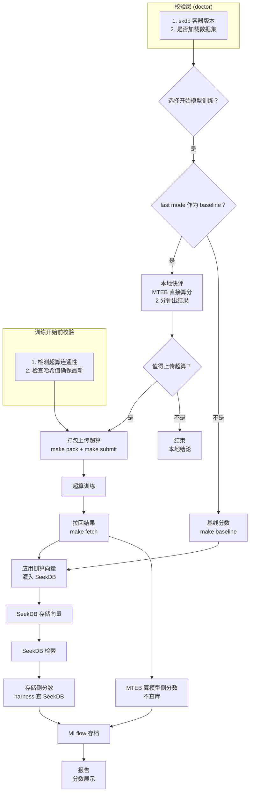

# MVP 架构图



## MVP 说明

### 核心流程

```
校验层 → 本地快评 → 值得上传？ → 打包上传 → 超算训练 → 拉回
                                                        │
                                                        ▼
                                              应用侧算向量 → 灌入 SeekDB
                                                        │
                                    ┌───────────────────┴───────────────────┐
                                    ▼                                       ▼
                              MTEB 算模型侧分数                        harness 查 SeekDB
                              (不查库)                                  (存储侧分数)
                                    │                                       │
                                    └───────────────────┬───────────────────┘
                                                        ▼
                                                  MLflow 存档
                                                        │
                                                        ▼
                                                    报告（分数）
```

### MVP 包含

| 模块 | 说明 |
|---|---|
| **校验层** | doctor 检查容器版本、数据集 |
| **本地快评** | MTEB 2 分钟出模型侧分数 |
| **超算上传** | pack + submit + fetch |
| **向量路径** | 应用侧算向量 → SeekDB 存储（单一路径） |
| **两层分数** | 模型侧（MTEB）+ 存储侧（harness 查 SeekDB） |
| **存档** | MLflow 记录实验 |
| **报告** | 分数展示 |

### MVP 不包含（stub）

| 模块 | 说明 |
|---|---|
| **Embedding 双路径** | 只有应用侧向量化，没有 skdb AI_EMBED |
| **归因分析** | 只展示分数，不自动归因 |
| **门禁** | 无自动阻断 |
| **客户端分数** | 无量化配置评测 |
| **消融扫描** | 无变体对比 |
| **分桶展开** | 无语言/长度/来源维度 |
